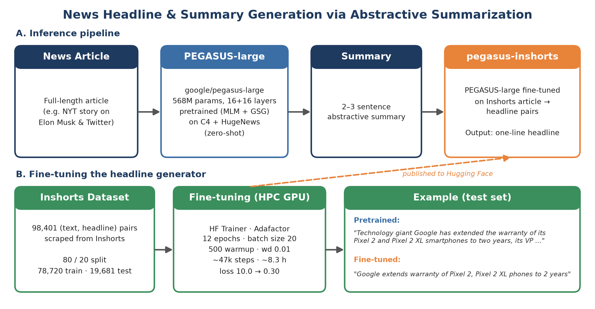

# News Headline and Summary Generation through Abstractive Summarization


[](https://huggingface.co/kubershahi/pegasus-inshorts)


**Advanced Machine Learning (CS 2490) Final Project** · Kuber Shahi

Can a model read a full news article and write an Inshorts-style summary and headline for it? This repository builds a two-stage abstractive summarization pipeline on top of Google's PEGASUS. The pretrained `pegasus-large` condenses an article into a 2–3 sentence summary, and a version of the same model fine-tuned on ~98k Inshorts summary–headline pairs turns that summary into a one-line headline. The fine-tuned model is published on Hugging Face as [`kubershahi/pegasus-inshorts`](https://huggingface.co/kubershahi/pegasus-inshorts).

## Deliverables

| Artifact | Description |
|----------|-------------|
| [Final Project Presentation (PDF)](reports/project_presentation.pdf) | Slide deck covering the problem statement, abstractive vs. extractive summarization, the PEGASUS architecture and pretraining objectives, the fine-tuning setup, results, and a live demo. |
| [Fine-tuned Model (Hugging Face)](https://huggingface.co/kubershahi/pegasus-inshorts) | `pegasus-inshorts`: PEGASUS-large fine-tuned on Inshorts for headline generation (training checkpoint 47,000). |
| [Dataset (Kaggle)](https://www.kaggle.com/datasets/sunnysai12345/news-summary?select=news_summary_more.csv) | Inshorts "News Summary" dataset used for fine-tuning. |

## Overview

Given a news article, the goal is to generate a **summary of two to three sentences** and a **headline** for it. Both should be *abstractive* rather than *extractive*. An extractive summarizer copies the most important sentences from the article as-is, while an abstractive summarizer writes new sentences, often paraphrasing, that may not appear anywhere in the source. Abstractive summarization is harder because the output has to be grammatical and faithful to the article, but it is much closer to how a human editor writes.

News summarizers like Inshorts are popular because most readers want the gist of a story without reading the full article.



## Project Structure

```text
.
├── dataset/
│   ├── news_headline.csv               # 98,401 Inshorts (summary, headline) pairs used for fine-tuning
│   └── news_summary.csv                # 4,514 (summary, full article) pairs
├── scripts/
│   ├── train.py                        # Fine-tunes pegasus-large on news_headline.csv + before/after ROUGE
│   ├── train.sh                        # PBS job script for train.py (HPC GPU queue)
│   ├── evaluate_pretrained.py          # Zero-shot ROUGE of pegasus-large on the test split
│   ├── evaluate_pretrained.sh          # PBS job script for evaluate_pretrained.py
│   └── fetch_articles.py               # Fetches full article text from Inshorts "read more" links
├── notebooks/
│   ├── headline_generation.ipynb       # Main notebook: data split, zero-shot eval, fine-tuning setup, demo
│   ├── push_to_huggingface.ipynb       # Loads checkpoint-47000 and pushes it to the Hugging Face Hub
│   ├── scrape_inshorts.ipynb           # Inshorts scraper (credit: sunnysai12345/News_Summary)
│   └── test_torch.ipynb                # PyTorch environment sanity check
├── logs/
│   ├── train.log                       # Fine-tuning: per-step loss, runtime, before/after ROUGE
│   ├── train_err.log                   # stderr from the fine-tuning job
│   ├── evaluate_pretrained_gpu.log     # Zero-shot evaluation (GPU run)
│   └── evaluate_pretrained_cpu.log     # Zero-shot evaluation (CPU run)
├── assets/
│   ├── project-overview.png            # Pipeline and fine-tuning overview figure
│   └── data_overview.png               # Sample rows from the dataset
├── reports/
│   └── project_presentation.pdf
└── README.md
```

## Model: PEGASUS

[PEGASUS](https://arxiv.org/abs/1912.08777) (*Pre-training with Extracted Gap-sentences for Abstractive Summarization*) is a Transformer encoder–decoder designed specifically for summarization.

| Property | Value |
|----------|-------|
| Checkpoint | [`google/pegasus-large`](https://huggingface.co/google/pegasus-large) |
| Architecture | 16-layer encoder, 16-layer decoder |
| Parameters | 568,699,904 (568M) |
| Vocabulary size | 96,103 |
| Max input length | 1,024 tokens |
| Pretraining corpora | C4 (350M web pages) and HugeNews (1.5B news articles) |
| Pretraining objectives | Masked Language Modeling (MLM) + Gap-Sentence Generation (GSG) |

In **Gap-Sentence Generation**, whole sentences that matter most to the document are masked, and the model learns to generate them from the remaining text. This task closely resembles summarization, which is why PEGASUS transfers well to it with little or no fine-tuning.

## Pipeline

| Stage | Model | Input | Output |
|-------|-------|-------|--------|
| **1. Summarize** | `google/pegasus-large` (zero-shot) | Full news article | 2–3 sentence abstractive summary |
| **2. Headline** | `kubershahi/pegasus-inshorts` (fine-tuned) | Summary from stage 1 | One-line headline |

The headline model is trained on Inshorts data, where the input is already a ~60-word summary of a story. That is why stage 2 takes the stage-1 summary as input rather than the raw article.

## Dataset

The fine-tuning data is the [Inshorts News Summary dataset](https://www.kaggle.com/datasets/sunnysai12345/news-summary?select=news_summary_more.csv) from Kaggle, scraped from Inshorts with articles drawn from sources like Hindustan Times, India Today, and The Guardian.

| File | Rows | Columns | Used for |
|------|------|---------|----------|
| `news_headline.csv` | 98,401 | `text` (~60-word Inshorts summary), `summary` (headline) | Fine-tuning and evaluating the headline model |
| `news_summary.csv` | 4,514 | `text` (~60-word Inshorts summary), `summary` (full source article, ~340 words) | Reference article–summary pairs (not used for training) |


The headline data is split **80 / 20** (`random_state=25`) into **78,720 training** and **19,681 test** examples.

## Fine-tuning Setup

The model was fine-tuned with the Hugging Face `Trainer` as a PBS job on the university HPC GPU queue (`scripts/train.sh` → `scripts/train.py`).

| Hyperparameter | Value |
|----------------|-------|
| Base model | `google/pegasus-large` |
| Training examples | 78,720 |
| Optimizer | Adafactor |
| Epochs | 12 |
| Batch size (per device) | 20 |
| Warmup steps | 500 |
| Weight decay | 0.01 |
| Checkpointing | every 1,000 steps (last 5 kept) |
| Training runtime | 29,717 s (~8.3 h), ~31.8 samples/s |
| Training loss | 10.03 (start) → ~0.30 (epoch 12), mean 0.458 |

The released model is `checkpoint-47000` from this run.

## Quick Start

### Install dependencies

```bash
pip install torch transformers sentencepiece scikit-learn pytorch-ignite pandas numpy
```

### Generate a summary and headline

```python
import torch
from transformers import PegasusForConditionalGeneration, PegasusTokenizerFast

device = "cuda" if torch.cuda.is_available() else "cpu"
tokenizer = PegasusTokenizerFast.from_pretrained("google/pegasus-large")
summarizer = PegasusForConditionalGeneration.from_pretrained("google/pegasus-large").to(device)
headliner = PegasusForConditionalGeneration.from_pretrained("kubershahi/pegasus-inshorts").to(device)

def generate(model, text):
    inputs = tokenizer(text, truncation=True, padding=True, return_tensors="pt").to(device)
    output = model.generate(**inputs)
    return tokenizer.batch_decode(output, skip_special_tokens=True)[0]

article = "..."  # any news article
summary = generate(summarizer, article)
headline = generate(headliner, summary)
print(headline, "\n\n", summary)
```

### Reproduce the experiments

Run all commands from the repository root so the `dataset/` paths resolve.

```bash
# Zero-shot ROUGE of pegasus-large on the first 250 test examples
python scripts/evaluate_pretrained.py

# Full fine-tuning + before/after ROUGE on the whole test set (GPU recommended)
python scripts/train.py
```

On a PBS cluster, submit `qsub scripts/evaluate_pretrained.sh` or `qsub scripts/train.sh` from the repository root. Update the `cd` path and virtual environment in each `.sh` file first.

## Results

### Qualitative

Given the same test-set input, the pretrained model mostly copies the opening sentence of the article (extractive behavior), while the fine-tuned model writes a short, Inshorts-style headline:

| Model | Output |
|-------|--------|
| `pegasus-large` (pretrained) | *"Technology giant Google has extended the warranty of its Pixel 2 and Pixel 2 XL smartphones to two years, its VP of Product Management Mario Queiroz announced."* |
| **`pegasus-inshorts` (fine-tuned)** | ***"Google extends warranty of Pixel 2, Pixel 2 XL phones to 2 years"*** |

### Quantitative (ROUGE, `pytorch-ignite`, full test set of 19,681 examples)

| Model | ROUGE-1 F | ROUGE-L F |
|-------|-----------|-----------|
| `pegasus-large` (pretrained) | 0.130 | 0.130 |
| `pegasus-inshorts` (fine-tuned) | 0.083 | 0.083 |

The presentation reports the same before/after trend (0.13 → 0.08) from an earlier, smaller run on 10,000 examples for 10 epochs. The full 78,720-example run above produced the released model.

## Key Findings

1. **Fine-tuning changes the output style.** The pretrained model produces long, mostly extractive sentences. After fine-tuning, the model writes concise, headline-style text that paraphrases and compresses the input.
2. **Training converges cleanly.** Loss drops from ~10.0 to ~0.30 over 12 epochs on the full training set.
3. **ROUGE falls even though headlines look better.** ROUGE-1 F goes from 0.13 to 0.08. Unigram overlap rewards long, copy-heavy outputs and penalizes short paraphrases, so it understates abstractive quality here.
4. **Inference cost matters.** On CPU, generating one summary took about 1–1.5 minutes. Fine-tuning a 568M-parameter model is only practical on a GPU.

## Limitations

- **Non-standard ROUGE computation.** `calculate_rouge` passes each reference as a flat token list to ignite's `Rouge(multiref="best")`, which expects a *list of references per candidate*. As a result, precision and recall are skewed (precision ≈ 0.01–0.03 while recall equals F). Treat the numbers as relative within this project, not as comparable to published ROUGE scores. The `rouge-score` package would give standard values.
- **No validation set.** Training ran without held-out evaluation, so the checkpoint was chosen by step count rather than by validation loss.
- **Summary stage is zero-shot.** Stage 1 uses `pegasus-large` without fine-tuning, so its summaries are often long and extractive (see the Elon Musk demo in `notebooks/headline_generation.ipynb`). Fine-tuning it on the article → summary pairs in `news_summary.csv` is a natural next step.
- **Single domain.** Both training and evaluation use Indian English news from Inshorts. Performance on other outlets or domains was not measured.
